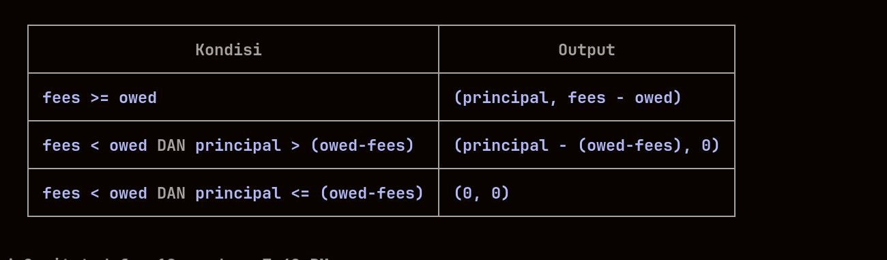
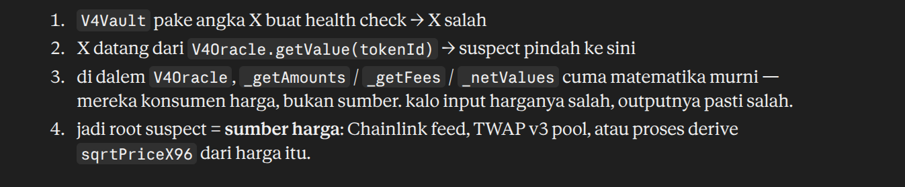
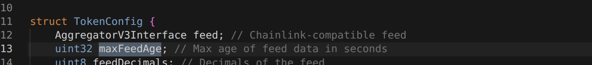
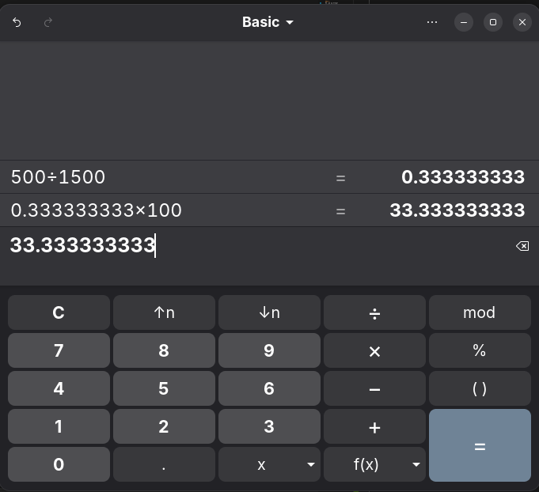
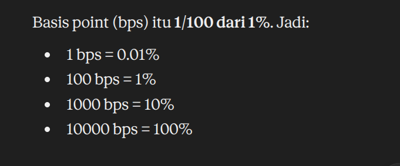
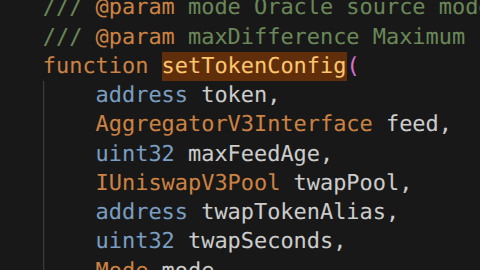
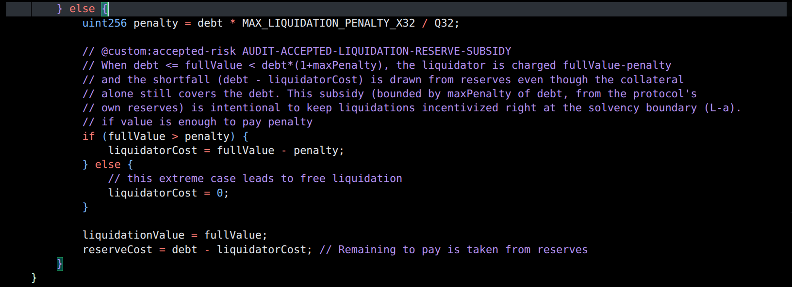

# v4lend

### 1.
-  collect smua data posisi shareholder
- get amount dari both token yang user punya
- calculate each fees(di dpetin dari each user yang ngeswap using the token) from each token
- jatah plugin dari pajak — nanti dipotong di _netValues
- harga token patokan ,pilar buat every token yang mau di convert
- calculate : value = total nilai tiket || feeValue : nilai pajak bersih.
- konversi harga token 0 & 1 dari satuan harga oracle ke harga patokan, harga token A ke B brp ? sebaliknbya

### 2.
 - principal = modal isi tiket utuh 
 - fees = pajak claim masih kotor
 - owed = ongkos plugin yang mau di potong

 ### 3.
 50,krena pajak claim lebih besar dri ongkos plugin, jadi modal gw gk ksntuh
 
 jadi selama pajak claim lebih gde dari ongkos plugin,modal kg ksntuh krena gk hrus nambal apa apa
 

 ### 4. 
 93. gw jg krang+

 ### 5.
0. krna modal sama pajak kurang buat ongkos plugin itu sndiri

### 6.

#### GetAmounts
hitung current balance yang bisa di withdraw dari ticket LP u. 

#### getFees
get growth fees buat each token yang LP ksh buat pool.

### 7. 
pas token patokan
salah satu currency0/currency1 tiket(harganya udah ada)


### 8.
cek file oracle(v4oracle.sol)krena staau gw barang ini selalu hrus terima dari oracle as first single receiver

                          

-------------------
## Sec 2

### 1.
- chainlink = feed harga external(latest round data) sumber "dunia luar"
- TWAP rata rata tick pool v4 selama window waktu (observe -> tick accumulate delta/periode). sumber "pool itu sndiri with anti spike protection"


### 2.
 - CHAINLINK_TWAP_VERIFY
 - TWAP_CHAINLINK_VERIFY
 - TWAP + 2 MODE

### 3.
di pake buat compare max perbedaan harga di 2 sc

### 4.
tergantung dari var maxfeedage itu sndiri,krena ya emg nilainya di isi lsng sama config,kek gk ada says explicit brp



### 5.
revert.
- kalo selisih harga itu di convert ke persen,dpet di skitar 33.3 ,exceed limit 10%



---

``` solidity
    /// @param maxDifferenceX10000 Maximum allowable difference expressed in basis points (e.g., 1000 = 10%)
    function _requireMaxDifference(uint256 priceX96, uint256 verifyPriceX96, uint16 maxDifferenceX10000) internal pure {
        if (maxDifferenceX10000 == type(uint16).max) {
            return;
        }

```

---

## sec 3
### 1. 
max collateralnya 90%
```
    // forge-lint: disable-next-line(unsafe-typecast)
    uint32 public constant MAX_COLLATERAL_FACTOR_X32 = uint32(Q32 * 90 / 100); // 90%
```


### 2.
dia pake yang 50% ,klo sistem take 70 ,itu bakal rugiin 2 pihak,cause either u gbs bayar krena asset not engh buat cover loan u


### 3. 
- collateralFactorX32 = convert token mentah jadi collateral,bassicly set hw valuable a token klo di jadiin aset.

- collateralValueLimitFactorX32 =
set how much loan yang bs user dapet based on collateral mereka .

### 4. 
none.  setTokenConfig gk ada modifier sama skli 



### 5.
dpet di kisaran 700 


### 6.
sehat.

### 7.
sakit.

### 8.
```
isHealthy = collateralValue >= debt;
```

---
## sec 4
### 
1. 2%(min) , 10%(max)

### 
2. progress nya linier,mereka hitung based on collateralValue(CV) handle debt,mkin susah CV handle debt,mkin gde bonus(insentif) buat yang lunasin utangnya

```
function _calculateLiquidation(uint256 debt, uint256 fullValue, uint256 collateralValue)
```

```
if (fullValue >= maxPenaltyValue)   →  tiket gemuk, bonus linier 2% → 10%
else                                 →  tiket tipis, bonus dipaksa 10%
```

### 3.
selalu di handle sama sistem dl ,krena lender itu fully optional klo dia emg mau lunasin


### 4.
reserveCost  =  sisa hutang yang kg kebayar sama penyita.

yg bayar reserveCost = sistem

### 5.
lender yang bakal handle (socialized loss)
```
1495:    // calculates if there are enough reserves to cover liquidaton - if not its shared between lenders
1501:        (, uint256 reserves) = _getBalanceAndReserves(newDebtExchangeRateX96, newLendExchangeRateX96);
1504:        if (reserveCost > reserves) {
1505:            missing = reserveCost - reserves;
```
### 6.
prevent self liquidaton,Healthy circular flow,double check via wallet proxy biar gbs di bypass pake wallet proxy


### 7.
```
if (liquidatingTokenId != 0 && liquidatingTokenId == params.tokenId) {
    revert Reentrancy();
}
```

### 8.
posisi nft tetep di pool,it just like regular liquidate,klo collateralValue(CV) still enough to cover ya u ttep dapat sisanya ,sisa = (debt + liquidator bonus)


##  sec 5
### 1. 2 pangkat 127
### 2. max slot angka buat type data int128
### 3. token fix di tolak sama v4lend
### 4.liquidasi tiket via chunk (pcs by pcs) gbs one chunk / 1 tx krena size valuenya terlalu gde
### 5. lsng reject token yng udh over supply cap,prevent drift pas mau di liquid