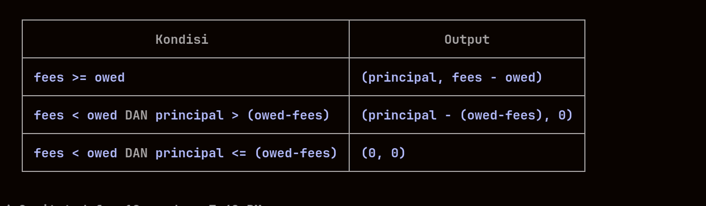
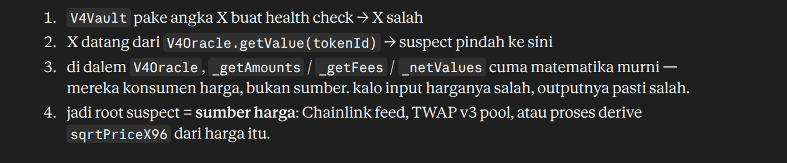

# v4lend

### 1.
-  collect smua data posisi shareholder
- get amount dari both token yang user punya
- calculate each fees(di dpetin dari each user yang ngeswap using the token) from each token
- jatah plugin dari pajak — nanti dipotong di _netValues
- harga token patokan ,pilar buat every token yang mau di convert
- calculate : value = total nilai tiket || feeValue : nilai pajak bersih.
- konversi harga token 0 & 1 dari satuan harga oracle ke harga patokan, harga token A ke B brp ? sebaliknbya

### 2.
 - principal = modal isi tiket utuh 
 - fees = pajak claim masih kotor
 - owed = ongkos plugin yang mau di potong

 ### 3.
 50,krena pajak claim lebih besar dri ongkos plugin, jadi modal gw gk ksntuh
 
 jadi selama pajak claim lebih gde dari ongkos plugin,modal kg ksntuh krena gk hrus nambal apa apa
 

 ### 4. 
 930.

 ### 5.
0. krna modal sama pajak kurang buat ongkos plugin itu sndiri

### 6.

#### GetAmounts
hitung current balance yang bisa di withdraw dari ticket LP u. 

#### getFees
get growth fees buat each token yang LP ksh buat pool.

### 7. 
hrus tau di convert ke 1 token apa.

### 8.
cek file oracle(v4oracle.sol)krena staau gw barang ini selalu hrus terima dari oracle as first single receiver

