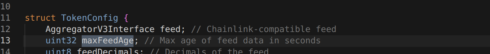
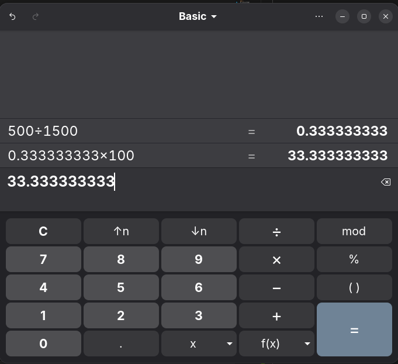
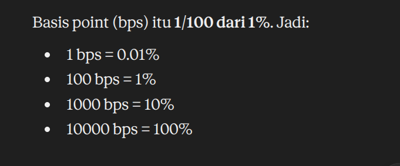

# v4lend

### 1.
-  collect smua data posisi shareholder
- get amount dari both token yang user punya
- calculate each fees(di dpetin dari each user yang ngeswap using the token) from each token
- jatah plugin dari pajak — nanti dipotong di _netValues
- harga token patokan ,pilar buat every token yang mau di convert
- calculate : value = total nilai tiket || feeValue : nilai pajak bersih.
- konversi harga token 0 & 1 dari satuan harga oracle ke harga patokan, harga token A ke B brp ? sebaliknbya

### 2.
 - principal = modal isi tiket utuh 
 - fees = pajak claim masih kotor
 - owed = ongkos plugin yang mau di potong

 ### 3.
 50,krena pajak claim lebih besar dri ongkos plugin, jadi modal gw gk ksntuh
 
 jadi selama pajak claim lebih gde dari ongkos plugin,modal kg ksntuh krena gk hrus nambal apa apa
 

 ### 4. 
 93. gw jg krang+

 ### 5.
0. krna modal sama pajak kurang buat ongkos plugin itu sndiri

### 6.

#### GetAmounts
hitung current balance yang bisa di withdraw dari ticket LP u. 

#### getFees
get growth fees buat each token yang LP ksh buat pool.

### 7. 
pas token patokan
salah satu currency0/currency1 tiket(harganya udah ada)


### 8.
cek file oracle(v4oracle.sol)krena staau gw barang ini selalu hrus terima dari oracle as first single receiver

                          

-------------------
## Sec 2

### 1.
- chainlink = feed harga external(latest round data) sumber "dunia luar"
- TWAP rata rata tick pool v4 selama window waktu (observe -> tick accumulate delta/periode). sumber "pool itu sndiri with anti spike protection"


### 2.
 - CHAINLINK_TWAP_VERIFY
 - TWAP_CHAINLINK_VERIFY
 - TWAP + 2 MODE

### 3.
di pake buat compare max perbedaan harga di 2 sc

### 4.
tergantung dari var maxfeedage itu sndiri,krena ya emg nilainya di isi lsng sama config,kek gk ada says explicit brp



### 5.
revert.
- kalo selisih harga itu di convert ke persen,dpet di skitar 33.3 ,exceed limit 10%



---

``` solidity
    /// @param maxDifferenceX10000 Maximum allowable difference expressed in basis points (e.g., 1000 = 10%)
    function _requireMaxDifference(uint256 priceX96, uint256 verifyPriceX96, uint16 maxDifferenceX10000) internal pure {
        if (maxDifferenceX10000 == type(uint16).max) {
            return;
        }

```
 